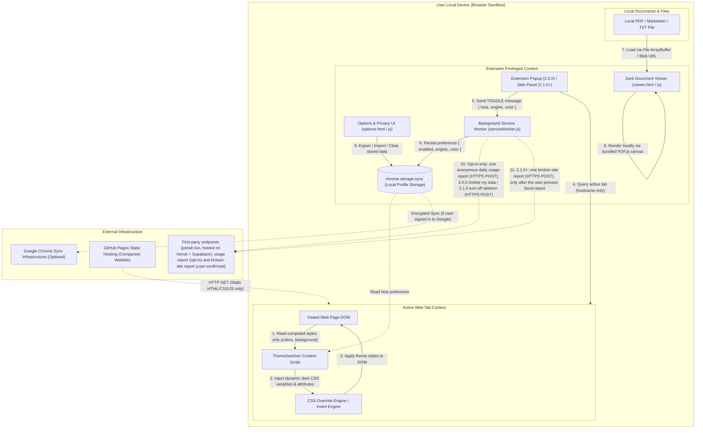

# ThemeSwitcher Data Flow Map

This document maps all architectural boundaries and data flows within the ThemeSwitcher browser extension and companion website.

---

## 1. Architectural Boundary Map

---

## 2. Granular Data Flow Analysis

### Flow 1: Web Page Recoloring (Content Script)
- **Source:** Web Page DOM computed styles (`getComputedStyle`).
- **Data Extracted:** Background color, text color, element dimensions, image/svg tag types.
- **Data Not Extracted:** Text content, form input, cookies, tokens.
- **Destination:** In-memory algorithm inside the tab's isolated world.
- **Egress:** **Zero.** Nothing leaves the tab.

### Flow 2: Extension Popup & Preference Toggle
- **Source:** User clicks extension action icon.
- **Data Extracted:** Active tab URL -> parsed to extract hostname only (`location.hostname`).
- **Data Minimization:** No path or query parameters are transmitted.
- **Message Transmitted:** `{ type: "TOGGLE", host: "example.com", engine: "css", backgroundColor: "#0f1115" }`.
- **Destination:** Background Service Worker -> `chrome.storage.sync`.
- **Egress:** **Zero.** Internal Chrome runtime message passing only.

### Flow 3: Dark Document Viewer
- **Source:** Local user-selected file or document URL.
- **Processing:** Client-side ArrayBuffer read -> Rendered to `<canvas>` via bundled `pdf.min.mjs` and `pdf.worker.min.mjs`.
- **Sandbox Isolation:** Fallback iframe runs with `sandbox="allow-scripts"` and `referrerpolicy="no-referrer"`.
- **Egress:** **Zero.** Documents never leave the user's browser and are never part of the usage statistics.

### Flow 4: Opt-in anonymous usage statistics (version 2.0.0)
- **Source:** Local counters kept by the background service worker in `chrome.storage.local`, only after the user clicks Yes in the popup or enables Usage stats in Options. Off by default. Version 2.0.0 only; version 2.1.0 and later use the usage report in Flow 5.
- **Data Sent:** random ID, UTC day, extension version, Chrome major version, OS family, UI language, and yes/no flags for engine, built-in theme and feature used.
- **Data Not Sent:** hostnames, URLs, page content, documents, typed text, custom CSS or theme colours. Our server function does not store IP addresses (platform request logs may transiently contain them, along with the browser's User-Agent and Accept-Language headers).
- **Destination:** the developer's first-party endpoints `https://pshah.fun/api/darkmode-telemetry` and `https://pshah.fun/api/darkmode-telemetry-delete` (hosted on Vercel and Supabase, which process the data on our behalf). Only combined totals (never individual reports or random IDs) are published at darkmode.pshah.fun/stats.html, and groups of fewer than 10 installs are never shown. The service worker is the only sender; the popup, side panel and content scripts never make network requests.
- **Access model:** the extension declares no host permissions; the endpoints answer CORS only for the extension's own origin (`chrome-extension://kmhhphbakbhohiohagkhhgdgfbplkfke`), set statically without reading any request header.
- **Egress:** **Only when opted in**, once per day, plus a delete request when the user clicks Delete my data. Otherwise zero. The combined totals published at the stats page come from these 2.0.0 reports and stop being updated as people move to 2.1.0.

### Flow 5: Optional usage report (version 2.1.0 and later)
- **Source:** Counters kept by the background service worker, only after the user presses **Turn on** on the side-panel card or switches on **Usage report** in Options. Off by default. People who opted in to the 2.0.0 statistics are asked once to confirm; nothing is sent from their install until they do.
- **Data Sent:** `id` (random), `day` (UTC), `version`, `engines.auto` / `engines.css` / `engines.invert` (used that day, yes or no), and `sites` (a count of the sites dark mode was applied on that day).
- **Data Not Sent:** which sites, URLs, page content, documents or typed text. To count each site once, the extension keeps a daily list of hashes of site names in local storage, replaced each day; the list never leaves the device and only the final number is sent.
- **Send pattern:** the same day's report may be sent again, replacing the earlier one, when the engines or the site count change, at most once an hour.
- **Destination:** `https://pshah.fun/api/darkmode-telemetry` (hosted on Vercel and Supabase, which process the data on our behalf). Individual reports and random IDs are not published; they are used to count daily and weekly users, retention and versions in use.
- **Turning off:** untick Usage report in Options (or press No thanks on the confirmation card). This asks `https://pshah.fun/api/darkmode-telemetry-delete` to delete the records for the ID and forgets the ID; if the server cannot be reached the extension keeps the ID only to retry, each time the browser starts the extension, until the server confirms.
- **Egress:** **Only when opted in.** Otherwise zero.

### Flow 6: Broken-site report (version 2.1.0 and later)
- **Source:** The user presses **Report this site as broken** in the side panel, reads what will be sent (the confirmation shows the domain), then presses **Send report**. Asked every time; never sent on its own.
- **Data Sent:** `site` (domain only), `engine` (auto, css or invert), `theme` (a built-in theme name, or custom or default) and `version`.
- **Data Not Sent:** page address, path, query, page content, custom CSS text, theme colours, file names, anything typed. There is no install ID, account or cookie, so reports are not linked to the user or to each other, and a single report cannot be looked up or deleted afterwards.
- **Server side:** the server adds the UTC date and counts repeats. Our server function does not store IP addresses (platform request logs may transiently contain them, along with the browser's User-Agent and Accept-Language headers). Reports are purged automatically after 13 months and are used only to find and fix sites that look wrong.
- **Local note:** the extension remembers on the device only which domains were reported today (domain and date) so a second tap says "Already reported today". That note is never sent.
- **Destination:** `https://pshah.fun/api/darkmode-report` (hosted on Vercel and Supabase, first-party). The service worker is the only sender.
- **Egress:** **Only when the user presses Send report.** Otherwise zero.

### Flow 7: Web PDF in the viewer
- **Source:** The user opens a web PDF in the viewer.
- **Egress:** The extension downloads that PDF directly from the site that hosts it. This is the only other network request the extension makes; nothing is sent to the developer.

### Flow 8: Companion Website
- **Source:** Browser navigation to `https://darkmode.pshah.fun`.
- **Delivery:** Static GitHub Pages CDN delivery over HTTPS.
- **Egress:** No analytics scripts, no third-party counter APIs, fonts or tracking pixels. The site makes one cookie-free visit-count request to pshah.fun per browser, and the public stats page makes one GET to the developer's own stats endpoint.
