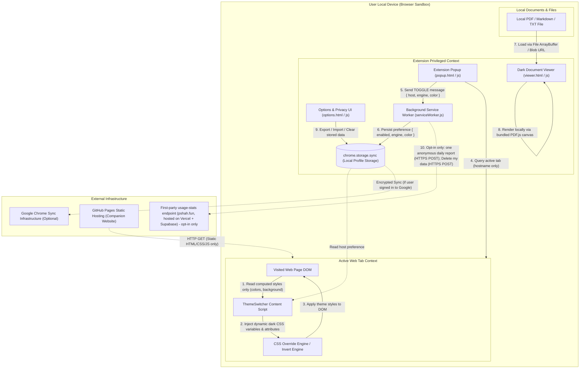

# ThemeSwitcher Data Flow Map

This document maps all architectural boundaries and data flows within the ThemeSwitcher browser extension and companion website.

---

## 1. Architectural Boundary Map

---

## 2. Granular Data Flow Analysis

### Flow 1: Web Page Recoloring (Content Script)
- **Source:** Web Page DOM computed styles (`getComputedStyle`).
- **Data Extracted:** Background color, text color, element dimensions, image/svg tag types.
- **Data Not Extracted:** Text content, form input, cookies, tokens.
- **Destination:** In-memory algorithm inside the tab's isolated world.
- **Egress:** **Zero.** Nothing leaves the tab.

### Flow 2: Extension Popup & Preference Toggle
- **Source:** User clicks extension action icon.
- **Data Extracted:** Active tab URL -> parsed to extract hostname only (`location.hostname`).
- **Data Minimization:** No path or query parameters are transmitted.
- **Message Transmitted:** `{ type: "TOGGLE", host: "example.com", engine: "css", backgroundColor: "#0f1115" }`.
- **Destination:** Background Service Worker -> `chrome.storage.sync`.
- **Egress:** **Zero.** Internal Chrome runtime message passing only.

### Flow 3: Dark Document Viewer
- **Source:** Local user-selected file or document URL.
- **Processing:** Client-side ArrayBuffer read -> Rendered to `<canvas>` via bundled `pdf.min.mjs` and `pdf.worker.min.mjs`.
- **Sandbox Isolation:** Fallback iframe runs with `sandbox="allow-scripts"` and `referrerpolicy="no-referrer"`.
- **Egress:** **Zero.** Documents never leave the user's browser and are never part of the usage statistics.

### Flow 4: Opt-in anonymous usage statistics
- **Source:** Local counters kept by the background service worker in `chrome.storage.local`, only after the user clicks Yes in the popup or enables Usage stats in Options. Off by default.
- **Data Sent:** random ID, UTC day, extension version, Chrome major version, OS family, UI language, and yes/no flags for engine, built-in theme and feature used.
- **Data Not Sent:** hostnames, URLs, page content, documents, typed text, custom CSS or theme colours. Our server function does not store IP addresses (platform request logs may transiently contain them, along with the browser's User-Agent and Accept-Language headers).
- **Destination:** the developer's first-party endpoints `https://pshah.fun/api/darkmode-telemetry` and `https://pshah.fun/api/darkmode-telemetry-delete` (hosted on Vercel and Supabase, which process the data on our behalf). Only combined totals (never individual reports or random IDs) are published at darkmode.pshah.fun/stats.html, and groups of fewer than 10 installs are never shown. The service worker is the only sender; the popup and content scripts never make network requests.
- **Access model:** the extension declares no host permissions; the endpoints answer CORS only for the extension's own origin (`chrome-extension://kmhhphbakbhohiohagkhhgdgfbplkfke`), set statically without reading any request header.
- **Egress:** **Only when opted in**, once per day, plus a delete request when the user clicks Delete my data. Otherwise zero.

### Flow 5: Companion Website
- **Source:** Browser navigation to `https://darkmode.pshah.fun`.
- **Delivery:** Static GitHub Pages CDN delivery over HTTPS.
- **Egress:** No analytics scripts, no third-party counter APIs, fonts or tracking pixels. The site makes one cookie-free visit-count request to pshah.fun per browser, and the public stats page makes one GET to the developer's own stats endpoint.
